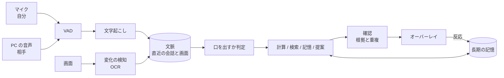

# ai-zuchi

PC の音声と画面をそばで見聞きし、頼まなくても必要なときにだけ、ひとこと補足してくれる個人用の AI 相棒。Mac と Windows で動き、LLM と文字起こしは手元で動かす。

> 状態: 部品はつながったが、実機の音声と画面での確認はこれから。決定事項と理由は [docs/設計メモ.md](docs/設計メモ.md) を参照。

## やりたいこと

質問されるのを待たず、耳にしたことや目にしたことから、役に立ちそうな補足を出す。

| きっかけ | 種類 | 補足の例 |
|---|---|---|
| 「3カ月で10億件かぁ」と耳にした | 計算 | 「秒間約127件、1日約1,100万件ですね」 |
| 「BONXの差別化ってなんなんですかね」と耳にした | 調べもの | 「IP ボイスインカムの中で、ハンズフリー用途で人気のようです」 |
| 「こちらご確認ください」と画面で見かけた | 行動の提案 | 「リマインドをセットしますか?」 |
| 「前に決めたあれ、どうなったっけ」と耳にした | 記憶 | 「10/20 の打ち合わせでは、A 案に決まっていました」 |

## 大事にすること

1. **黙っているのが基本。** 余計なひとことは、見逃しより悪い
2. **画面の端に静かに出す。** 声は出さない。読むか無視するかは本人が決める
3. **データは手元に置く。** 外へ出すのは、本人が確認できる検索語だけ
4. **勝手に動かない。** リマインドの登録などは、本人の操作があってから行う
5. **使うほど育つ。** 反応と記憶から、その人に合うひとことを覚える

## 処理の流れ



## 技術方針

| 領域 | 方針 | 状態 |
|---|---|---|
| アプリ | Tauri 2(Rust + React + TypeScript) | 仮決定 |
| LLM | Ollama を HTTP で使う。モデルは Gemma 4 E4B から検証する | 要検証 |
| 文字起こし | sherpa-onnx、silero VAD、日本語 zipformer を発話区間ごとに使う | 要検証 |
| PC の音声 | macOS は Core Audio tap(Swift の補助プログラム)、Windows は WASAPI loopback | 要検証 |
| 画面 | ScreenCaptureKit / Windows.Graphics.Capture と OS の OCR | 要検証 |
| 記憶 | SQLite(FTS5 + ベクトル検索)と埋め込みモデル | 要検証 |
| Web 検索 | SearXNG を既定にする。Brave Search API にも切り替えられる | 仮決定 |
| ツール管理 | mise | 決定 |

「要検証」は、手元で測るまで決定事項として扱わない。

## 開発

ツールの版は [mise.toml](mise.toml) で固定する。

```bash
mise install
```
